# Ambilight WLED

## О проекте
Ambilight WLED — это система динамической фоновой подсветки для телевизоров и мониторов. Данный проект использует **камеру и компьютерное зрение** для анализа изображения в реальном времени, что позволяет работать с любым источником сигнала (HDMI, браузер, игры) без захвата видеокарты.

Амбилайт для 85" ТВ: Raspberry Pi 5 + Camera Module 3 Wide (потолочный монтаж)
→ 340 зон → DDP по WiFi → ESP32 с WLED → WS2812B 340 LED.

## Архитектура 

Система построена по модели **Producer-Consumer** с односторонним потоком данных по UDP (DDP).

```mermaid
graph LR
    subgraph Capture_System ["Система захвата и обработки"]
        CAM["Камера OV5647<br/>Захват видеопотока"]
        PI["Raspberry Pi 5<br/>Producer<br/>OpenCV / NumPy / Python"]
        CAM -- "CSI шлейф<br/>Raw Video Frames" --> PI
    end

    subgraph Network ["Сетевой транспорт"]
        UDP["DDP Protocol<br/>UDP Port 4048<br/>Drop-policy: без ретраев"]
    end

    subgraph LED_System ["Система управления периферией"]
        ESP["ESP32 DevKit<br/>Consumer / WLED"]
        LED["WS2812B Лента<br/>340 независимых зон"]
        ESP -- "FastLED RMT<br/>GPIO 16 + 74AHCT125" --> LED
    end

    PI -- "RGB пакеты<br/>~30 FPS, Latency &lt; 50ms" --> UDP
    UDP -- "WiFi / Ethernet<br/>Локальная сеть" --> ESP

    classDef hardware fill:#f9f9f9,stroke:#333,stroke-width:2px;
    classDef protocol fill:#e1f5fe,stroke:#03a9f4,stroke-width:1px,stroke-dasharray: 5 5;

    class CAM,PI,ESP,LED hardware;
    class UDP protocol;
```



## Ключевые особенности
- 340 независимых зон (1 LED = 1 зона) для плавного свечения без артефактов.
- **Двухэтапная калибровка:** 
  - *Геометрическая:* ArUco-маркеры → гомография → remap-карты (компенсация keystone-эффекта).
  - *Фотометрическая:* Компенсация цветового сдвига VA/QLED панелей при наблюдении под углом.
- DDP (Distributed Display Protocol) over UDP. Потерянный кадр дропается ради сохранения минимальной задержки (<50ms).
- Полная поддержка Home Assistant через MQTT Auto-Discovery.

## Компоновка железа
- Pi 5 + камера (CSI-шлейф ≤ 30 см), питание USB-C 27 Вт (вычислительный блок под потолком).
  Камера в 1.0–1.3 м перед плоскостью экрана, объектив ~2.35–2.45 м, наклон
  вниз на центр экрана, ориентация альбомная.
- ESP32 (WLED) вплотную к началу ленты + 74AHCT125 + БП LRS-350-5 (исполнительный блок за ТВ).
- Связь Pi ↔ ESP32 — WiFi (DDP, порт 4048). Физические провода между Pi и ESP32 отсутствуют.

## Демонстрация работы


Примечание к демо. Важно понимать, что лента в этой системе привязана не к оригинальному изображению, а к тому, что распознаёт камера. На экране это видно наглядно: слева — оригинал с чистыми цветами, справа — кадр с камеры (OV5647), где оттенки уже искажены оптикой и сенсором. Цвет ленты в момент съёмки совпадает с границами правой половины экрана — то есть система корректно отрабатывает весь пайплайн «камера → зоны → лента». Расхождение ленты от оригинала слева — это ожидаемое поведение, обусловленное цветопередачей камеры, а не баг алгоритма.

## Установка
1. ESP32: прошить WLED — см. `wled/SETUP.md`.
2. Pi: `bash deploy/setup.sh`, отредактировать `/opt/ambilight/config/config.yaml`
   (MQTT-брокер HA, host WLED), `sudo systemctl start ambilight`.
3. Калибровка — `docs/CALIBRATION.md` (15 минут, через браузер).
4. HA обнаружит всё сам: WLED — по zeroconf, сущности engine — по MQTT Discovery.

## Структура проекта
```
engine/             конвейер (Python 3.11+)
  capture.py        Picamera2, фиксированные controls, ring buffer
  calib/            геометрия (ArUco→гомография→remap), фотометрия, паттерны
  zones.py          340 зон, векторное усреднение
  smoothing.py      time-based EMA (FPS-инвариантный) + круговой Gaussian
  scene.py          эвристики сцен (movie/game/news/static) + профили
  overlay.py        уведомления pulse/flash/sweep/blink поверх потока
  color.py          WB, насыщенность, black threshold, лимит мощности, гамма
  transport.py      DDP (UDP) / Adalight (UART), без retry кадров
  mqtt.py           HA Discovery, сенсоры, команды
  webui/api.py      healthz, превью, мастер калибровки
config/config.yaml  всё настраиваемое
deploy/             systemd + setup.shs
wled/SETUP.md       настройка ESP32
ha/automations.yaml примеры автоматизаций
tests/              pytest
requirements.txt    версии зависимостей
```

## Быстрый старт
1. Установка на Raspberry Pi
```
git clone https://github.com/YarValerievich/ambilight-wled.git
cd ambilight-pro

python3 -m venv --system-site-packages venv
source venv/bin/activate

pip install -r requirements.txt
```
2. Настройка WLED
   
Прошейте ESP32 прошивкой WLED.
В настройках LED Preferences укажите:
LED Count: 340
GPIO: 16
Color Order: GRB
Сохраните Preset #1 как "Black" (выключено) и настройте Apply at boot.

4. Запуск
```
python -m engine.main config/config.yaml
```

## Диагностика
- `http://<pi>:8000/healthz` — статус; `/raw.jpg`, `/preview.jpg` — камера.
- Сенсоры HA: fps, latency_ms, cpu_temp, scene, power_w, calibration_ok.
- Pi упал → WLED через 2.5 с плавно уходит в fallback-пресет (watchdog WLED), предотвращая "зависание" яркого кадра.

## Интеграция с Home Assistant
Проект поддерживает MQTT Auto-Discovery. После подключения к брокеру в HA автоматически появятся:
- switch.ambilight — вкл/выкл
- select.ambilight_profile — выбор профиля (Movie, Game, News)
- sensor.ambilight_fps — текущий FPS
- sensor.ambilight_power_w — потребляемая мощность
